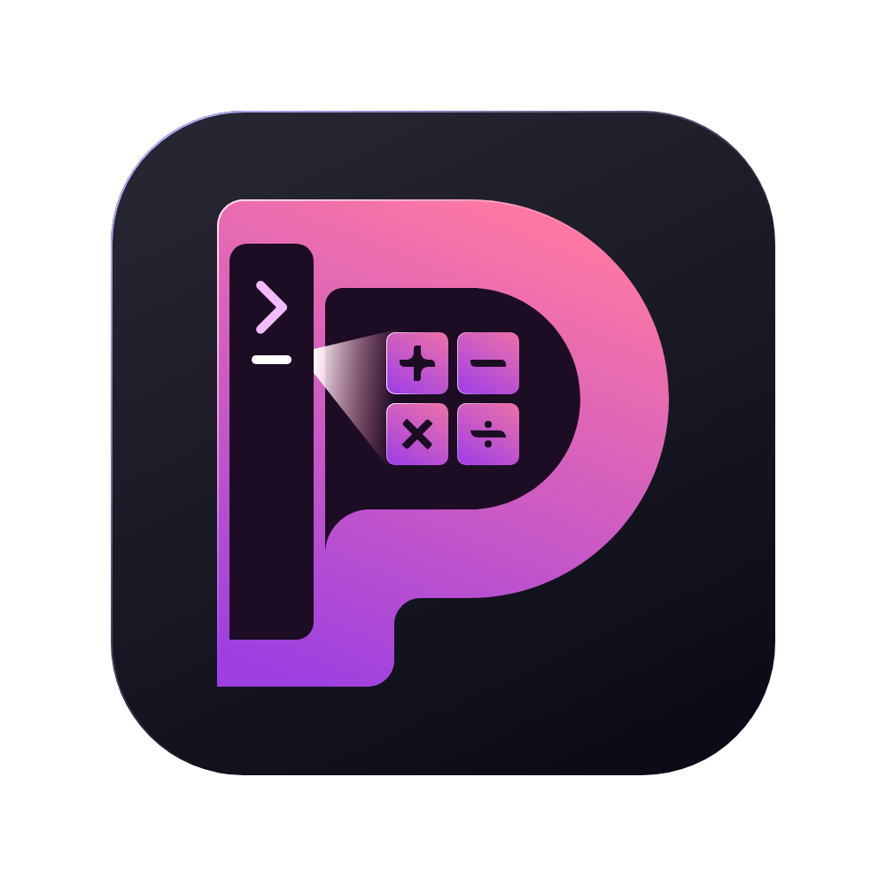

<p align="center">
  
</p>

<h1 align="center">Prospero</h1>

<p align="center">
  A fast, keyboard-driven launcher for Windows.
</p>

Prospero is a small app that sits quietly in the background and opens the moment you need it. Press a hotkey, start typing, and it searches everything at once: the apps on your computer, a calculator, and a set of built-in commands. Results appear instantly, and the best match is always selected for you. Press Enter to run it, or use the arrow keys to pick a different one.

It is still young and under active development, but the core launcher is already usable day to day.

> New here? Take a look at [FEATURES.md](docs/FEATURES.md) for the full list of what works today, what is being built, and what is planned.

<!-- ## Screenshots -->

<!--
  These are placeholders. Replace each file in docs/assets/ with a real screenshot
  of the same name and the image will show up automatically.
-->

<!--

*The main window: query box on top, results below.*


*A calculation with units and a copy-to-clipboard result.*


*Searching for an app from the Start Menu.*
-->

## Quick start

**Option 1 — installer (recommended)**

1. Go to the [Releases](https://github.com/VasigaranAndAngel/Prospero/releases) page.
2. Download the latest `ProsperoSetup-*.exe`.
3. Run the installer, then launch Prospero.
4. Press `Alt + Space` anywhere to open it.

**Option 2 — run from source**

You need Windows and Python >=3.12. The project uses [uv](https://docs.astral.sh/uv/) for dependencies.

```powershell
uv sync --locked --all-extras --dev
uv run python -m src.main
```

## Basic controls

| Action                     | Keys                        |
| -------------------------- | --------------------------- |
| Open / Select all (query)  | `Alt + Space`               |
| Next result                | `Tab` or `Down`             |
| Previous result            | `Shift + Tab` or `Up`       |
| Select result              | `Click`                     |
| Run the selected result    | `Enter` or `Double Click`   |
| Close the window           | `Esc`                       |
| Move the window            | Drag it with the mouse      |

## What it can do (quick list)

Full details, examples, and developer notes for every item live in [FEATURES.md](docs/FEATURES.md).

**Search & launcher**
- Global hotkey, always-on-top window, and tray icon — *implemented*
- Fast fuzzy search across all providers at once — *implemented*
- Every provider searches on its own thread, with a loading indicator — *implemented*

**Providers**
- Calculator: math, units, multiple sums, variables — *implemented* | *More planned*
- Applications: launch Start Menu and UWP apps, optional recent files — *implemented* | *More Planned*
- Commands: power options, updater, version, etc. — *implemented* | *More planned*
- Color, File System, Volume, Terminal, Clipboard and more — *planned*

**Look & feel**
- System / Dark / Light mode and custom TOML themes — *Partially implemented*
- Highly customizable query box placeholders with time, app, and system info — *Partially implemented*
- Settings window — *Under construction*
- Customizable look and animations — *Planned*

**Under the hood**
- TOML config file that reloads when it changes — *Partially implemented*
- Command-line arguments for config, theme, debug, offline, and more — *Partially implemented*
- Auto-updater from GitHub releases — *implemented*
- Grammar, Tags and aliases, Query preset, VIM mode — *planned*

## Configuration

Prospero keeps its settings in a single TOML file:

```
%USERPROFILE%\.config\Prospero\Prospero.toml
```

The file is created with sensible defaults the first time you run the app, and Prospero watches it, so changes apply without a restart. You can point at a different file with the `--config` argument. *Not implemented yet*

Themes are also TOML files. The theme in use is chosen by three settings: `theme_mode` (`System`, `Dark`, or `Light`), `dark_theme`, and `light_theme`. Pass `--theme`, `--dark-theme`, or `--light-theme` on the command line to override them for a single run. *Not implemented yet*

## Command-line arguments

```
prospero [options]
```

| Argument                        | What it does                                                          |
| ------------------------------- | --------------------------------------------------------------------- |
| `-v`, `--version`               | Print the version and exit                                            |
| `-c`, `--config <path>`         | Use a specific config file *Not implemented yet*                      |
| `-d`, `--debug`                 | Enable debug logging and the debug provider                           |
| `--cli`                         | Run in the terminal instead of the window *for the one who need this* |
| `--theme <path>`                | Use one theme file for both dark and light                            |
| `--dark-theme <path>`           | Set the dark theme file                                               |
| `--light-theme <path>`          | Set the light theme file                                              |
| `--offline`                     | Never connect to the internet                                         |
| `--update-domain <url>`         | Use a custom update server                                            |

## Build & development

```powershell
# install everything (including dev tools)
uv sync --locked --all-extras --dev

# run the tests
uv run pytest

# build a standalone executable
uv run PyInstaller prospero.spec --clean --noconfirm
```

## License

Released under the [MIT License](LICENSE).
